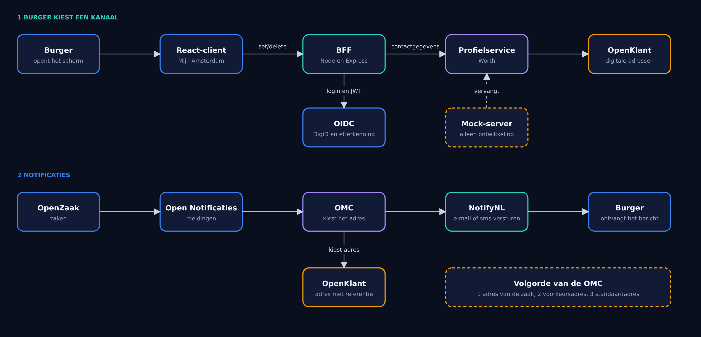
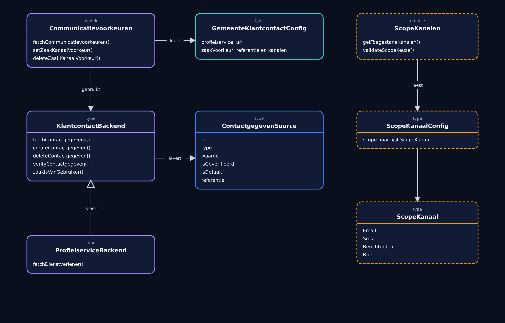

# Toelichting bij de diagrammen

Alle diagrammen horen bij de feature "communicatievoorkeuren per zaak" van de Landelijke Profiel Service (team 1). De code staat in `src/server/services/klantcontact/`.

## Sequence diagram: een burger kiest een kanaal voor een zaak

**Wat het laat zien:** de volgorde van berichten wanneer een burger voor een zaak een kanaal kiest.

1. De burger kiest in de browser een kanaal voor een zaak. Het scherm stuurt een POST naar `zaakvoorkeur/set` van de BFF.
2. De BFF controleert eerst of de zaak van de ingelogde burger is. Is dat niet zo, dan volgt een 403. Lukt de controle zelf niet, dan volgt een 503.
3. De BFF maakt in de profielservice een nieuw zaakadres aan. Dat adres is nog niet geverifieerd en krijgt een verificatiecode.
4. Pas daarna verwijdert de BFF het oude zaakadres.
5. De BFF meldt dat de keuze is opgeslagen. Het scherm toont de keuze aan de burger.

**Waarom in deze volgorde:** eerst aanmaken en dan verwijderen zorgt dat een mislukte aanmaak de burger niet zonder voorkeur achterlaat. De eigenaarscheck staat vooraan, zodat een burger geen voorkeur van een andermans zaak kan wijzigen (autorisatie, niet alleen authenticatie).

## Architecture diagram: de keten

**Deel 1, burger kiest een kanaal:** de burger gebruikt de React-client van Mijn Amsterdam. Die praat met de BFF (Node en Express), die de burger via DigiD of eHerkenning (OIDC) laat inloggen. De BFF roept de profielservice (Worth) aan, die de digitale adressen in OpenKlant opslaat. In ontwikkeling vervangt een mock-server de profielservice.

**Deel 2, notificaties:** een zaak in OpenZaak stuurt via Open Notificaties een melding naar de OMC. De OMC zoekt het adres in OpenKlant en laat NotifyNL de e-mail of sms versturen. De volgorde van adressen: eerst het adres van de zaak (referentie), dan het voorkeursadres, dan het standaardadres.

## Component diagram: de lagen in de code

De router stuurt aanvragen naar de route-handlers, die HTTP in en uit afhandelen. De handlers roepen de service-functies in `communicatievoorkeuren` aan. Die gebruiken de service-config (toggles, routes, configuratie), de helpers (mapping en referentie) en de `KlantcontactBackend` interface. De profieldienst implementeert die interface en praat via HTTP met de profielservice of de mock. De module `scope-kanalen` (gestippeld) valideert dat een scope maximaal één kanaal heeft en is nog niet aan de handlers gekoppeld.

## Class diagram: eigen oplossing

Het diagram toont de typen en modules van de eigen oplossing:

- `Communicatievoorkeuren`: ophalen, zetten en verwijderen van voorkeuren.
- `KlantcontactBackend`: de interface naar de backend, geïmplementeerd door `ProfielserviceBackend`.
- `ContactgegevenSource`: wat de backend teruggeeft (id, type, waarde, isGeverifieerd, isDefault, referentie).
- `GemeenteKlantcontactConfig`: de configuratie per gemeente.
- `ScopeKanalen`, `ScopeKanaalConfig` en `ScopeKanaal`: de module voor maximaal één kanaal per scope en standaard geen kanaal (privacy by default).
