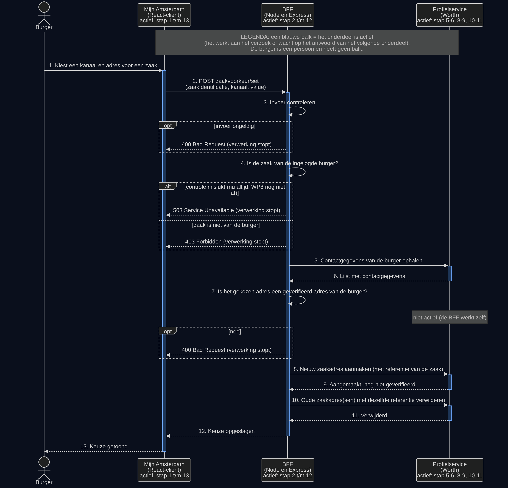
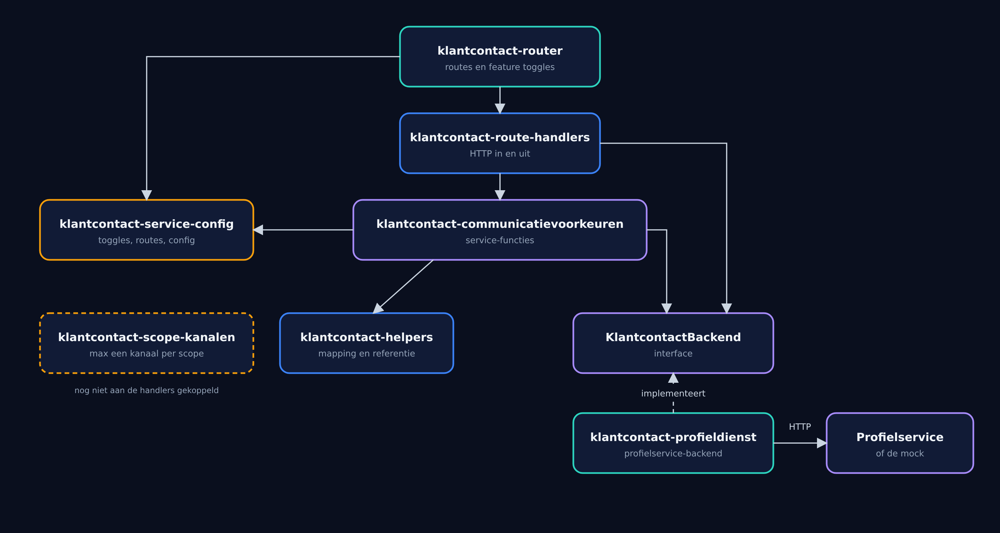

# Toelichting bij de diagrammen

Alle diagrammen horen bij de feature "communicatievoorkeuren per zaak" van de Landelijke Profiel Service (team 1). De code staat in `src/server/services/klantcontact/`.

## Sequence diagram: een burger kiest een kanaal voor een zaak

De bron van het diagram staat in [sequence-diagram.mmd](sequence-diagram.mmd) (Mermaid).

**Deelnemers:** de burger (persoon), Mijn Amsterdam (de React-client, dus de pagina Mijn contact in de browser van de burger), de BFF en de profielservice. In een eerdere versie stonden "Browser" en "Scherm" als aparte deelnemers. Dat was dezelfde client, dus nu staat er een persoon tegenover systemen.

**Onderdelen en wanneer ze actief zijn:** de blauwe balken op de lijnen in het diagram laten zien wanneer een onderdeel bezig is met dit verzoek, ook als het wacht op een antwoord van het volgende onderdeel. Een balk begint bij het bericht dat het onderdeel aanroept en eindigt bij het antwoord dat het teruggeeft. Boven elk onderdeel staat in het diagram ook tussen welke stappen het actief is, en de legenda bovenin legt de balken uit.

| Onderdeel | Wat is het | Wat doet het in dit diagram | Actief tijdens stap |
|---|---|---|---|
| Burger | Inwoner die is ingelogd met DigiD of eHerkenning | Kiest het kanaal en het adres (1) en ziet het resultaat (13). Is een persoon en geen systeem, dus heeft geen balk. | Geen balk |
| Mijn Amsterdam (React-client) | De pagina Mijn contact in de browser van de burger | Neemt de keuze van de burger aan, stuurt die naar de BFF (2) en toont het antwoord (13). Wacht ertussen op de BFF. | 1 tot en met 13 |
| BFF (Node en Express) | De server van Mijn Amsterdam tussen de client en de achterliggende diensten. Laat de burger inloggen. | Controleert de invoer (3), de eigenaar van de zaak (4) en het adres (7), roept de profielservice aan (5, 8 en 10) en stuurt het antwoord terug (12). | 2 tot en met 12 |
| Profielservice (Worth) | Dienst die de digitale adressen van de burger opslaat in OpenKlant. In ontwikkeling vervangt een mock-server hem. | Levert de contactgegevens (5 en 6), maakt het nieuwe zaakadres aan (8 en 9) en verwijdert de oude adressen (10 en 11). | 5 en 6, 8 en 9, 10 en 11 (drie korte balken) |

- Stap 3, 4 en 7 doet de BFF zelf. De profielservice is dan niet actief.
- Bij een fout (400, 403 of 503) stopt de verwerking bij de foutpijl en krijgt de client direct dat antwoord. De balken lopen in het diagram door, omdat alleen het gewone verloop (alles gaat goed) is getekend.

**Wat het laat zien:** de volgorde van berichten wanneer een burger voor een zaak een kanaal kiest.

1. De burger kiest in de client een kanaal en een adres voor een zaak.
2. De client stuurt een POST naar `zaakvoorkeur/set` van de BFF.
3. De BFF controleert de invoer (kanaal, waarde en zaakidentificatie). Is die ongeldig, dan volgt een 400.
4. De BFF controleert of de zaak van de ingelogde burger is. Is dat niet zo, dan volgt een 403. Lukt de controle zelf niet, dan volgt een 503.
5. en 6. De BFF haalt de contactgegevens van de burger op bij de profielservice.
7. De BFF controleert dat het gekozen adres een geverifieerd adres van de burger zelf is. Zo niet, dan volgt een 400.
8. en 9. De BFF maakt in de profielservice een nieuw zaakadres aan, met de referentie van de zaak. Dat adres is nog niet geverifieerd.
10. en 11. Pas daarna verwijdert de BFF de oude zaakadressen met dezelfde referentie.
12. en 13. De BFF meldt dat de keuze is opgeslagen en de client toont de keuze aan de burger.

**Waarom in deze volgorde:** eerst aanmaken en dan verwijderen zorgt dat een mislukte aanmaak de burger niet zonder voorkeur achterlaat. De eigenaarscheck staat vóór het ophalen en aanmaken van adressen, zodat een burger geen voorkeur van een andermans zaak kan wijzigen (autorisatie, niet alleen authenticatie).

**Klopt het met de code?** Gecontroleerd op 17 november 2026 tegen `src/server/services/klantcontact/`.

| Stap | Waar in de code |
|---|---|
| 2 | Route `ZAAKVOORKEUR_SET` in `klantcontact-service-config.ts`, geregistreerd in `klantcontact-router.ts` achter de toggle `KLANT_CONTACT.zaakvoorkeuren` en achter het inloggen |
| 3 | `handleSetZaakKanaalVoorkeur` in `klantcontact-route-handlers.ts`: kanaal, waarde en `getValidZaakReferentie` geven bij een fout 400 |
| 4 | `klantcontactBackend.zaakIsVanGebruiker`: status niet OK geeft 503, uitkomst `false` geeft 403 |
| 5 tot en met 7 | `fetchContactgegevens` en daarna de controle op een geverifieerd adres zonder referentie (400). Mislukt het ophalen, dan volgt een 500 |
| 8 tot en met 11 | `setZaakKanaalVoorkeur` in `klantcontact-communicatievoorkeuren.ts`: `createContactgegeven` met referentie en `isDefault: false`, daarna `deleteContactgegeven` voor alle adressen met dezelfde referentie |
| 12 en 13 | De client verwerkt het antwoord in `useSetZaakKanaalVoorkeur` (WP7) en toont de keuze |

**Bewust vereenvoudigd in het diagram:**

- Stap 5 gebeurt in de code twee keer: één keer in de handler (voor de adrescontrole) en één keer in `setZaakKanaalVoorkeur` (om de oude adressen te vinden). Het diagram toont het één keer.
- Mislukt het verwijderen in stap 10, dan geeft de service een foutmelding terwijl het nieuwe adres al bestaat. Bij de volgende keer worden de duplicaten opgeruimd.
- Bij stap 9 stuurt `createContactgegeven` volgens de code een verificatieverzoek. Het adres blijft ongeverifieerd tot de code is ingevoerd.

**Verschil tussen ontwerp en huidige stand:** stap 4 is nog een stub. De OpenZaak-aanroep (WP8) bestaat nog niet, dus `zaakIsVanGebruiker` geeft nu altijd een 503 (fail closed: liever geen voorkeur dan een voorkeur voor een zaak waarvan het eigenaarschap niet vaststaat). Het diagram toont de bedoelde werking. Zolang WP8 niet af is, stopt het proces in de praktijk bij stap 4.

## Architecture diagram: de keten

**Deel 1, burger kiest een kanaal:** de burger gebruikt de React-client van Mijn Amsterdam. Die praat met de BFF (Node en Express), die de burger via DigiD of eHerkenning (OIDC) laat inloggen. De BFF roept de profielservice (Worth) aan, die de digitale adressen in OpenKlant opslaat. In ontwikkeling vervangt een mock-server de profielservice.

**Deel 2, notificaties:** een zaak in OpenZaak stuurt via Open Notificaties een melding naar de OMC. De OMC zoekt het adres in OpenKlant en laat NotifyNL de e-mail of sms versturen. De volgorde van adressen: eerst het adres van de zaak (referentie), dan het voorkeursadres, dan het standaardadres.

## Component diagram: de lagen in de code

De router stuurt aanvragen naar de route-handlers, die HTTP in en uit afhandelen. De handlers roepen de service-functies in `communicatievoorkeuren` aan. Die gebruiken de service-config (toggles, routes, configuratie), de helpers (mapping en referentie) en de `KlantcontactBackend` interface. De profieldienst implementeert die interface en praat via HTTP met de profielservice of de mock. De module `scope-kanalen` (gestippeld) valideert dat een scope maximaal één kanaal heeft en is nog niet aan de handlers gekoppeld.

## Class diagram: eigen oplossing

Het diagram toont de typen en modules van de eigen oplossing:

- `Communicatievoorkeuren`: ophalen, zetten en verwijderen van voorkeuren.
- `KlantcontactBackend`: de interface naar de backend, geïmplementeerd door `ProfielserviceBackend`.
- `ContactgegevenSource`: wat de backend teruggeeft (id, type, waarde, isGeverifieerd, isDefault, referentie).
- `GemeenteKlantcontactConfig`: de configuratie per gemeente.
- `ScopeKanalen`, `ScopeKanaalConfig` en `ScopeKanaal`: de module voor maximaal één kanaal per scope en standaard geen kanaal (privacy by default).
