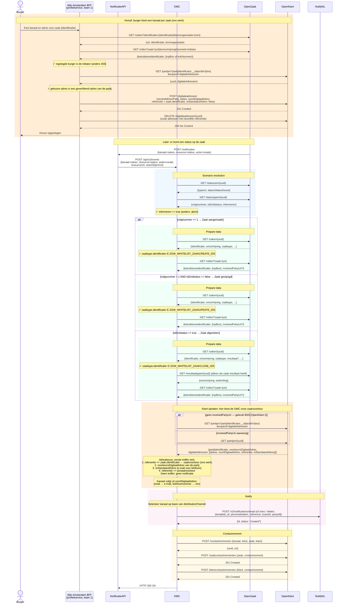

# Zaak aangemaakt

Dit scenario wordt geactiveerd wanneer een nieuwe zaak voor een burger of organisatie wordt geopend.

> Dit is de OMC-documentatie van het scenario "Zaak aangemaakt", aangevuld met de aansluiting van de profielservice (team 1). Onze aanvullingen staan in de sectie [Aansluiting profielservice](#aansluiting-profielservice-team-1) en in de oranje blokken van het sequence diagram.

***

## Triggercondities

Het OMC activeert dit scenario wanneer een event binnenkomt met de volgende kenmerken:

| Veld       | Vereiste waarde |
| ---------- | --------------- |
| `kanaal`   | `zaken`         |
| `resource` | `status`        |
| `actie`    | `create`        |

***

## Aansluiting profielservice (team 1)

### Eerste vraag: nieuw component of een bestaand component uitbreiden?

| Optie | Wat het betekent | Gevolg voor de OMC |
| --- | --- | --- |
| Nieuw component | Een eigen voorkeurenservice met een eigen API, waarin de kanaalkeuze per zaak staat | De OMC moet een extra registratie bevragen. Dat is een aanpassing in de OMC, en elke gemeente moet het component erbij draaien en beheren. |
| OpenKlant uitbreiden | De kanaalkeuze is een extra `DigitaalAdres` bij de partij, met `referentie = zaak.identificatie` | Geen aanpassing. De OMC haalt de digitale adressen al op en kiest eerst het adres met de `referentie` van de zaak (`PartyResults.TrySelectAddress`, v.2.3.2). |

**Besluit: we breiden OpenKlant uit.** We bouwen geen nieuw component en veranderen niets aan de software van OpenKlant. We vullen OpenKlant aan met gegevens in velden die al bestaan (`referentie`, `isStandaardAdres`, `verificatieDatum` in de Klantinteracties API, 0.7.0 op de testomgeving).

Waarom:

- **De OMC hoeft niet te veranderen.** Hij leest OpenKlant al, en de adreskeuze op `referentie` zit er al in. De OMC "aansluiten op onze service" betekent dus: dezelfde OpenKlant gebruiken.
- **Niets extra's te beheren.** Elke gemeente met OpenKlant 2 kan het gebruiken. Er komt geen nieuwe registratie bij met een eigen API, authenticatie en back-up.
- **Standaard-API.** De BFF praat met de Klantinteracties API zoals elke andere afnemer. In de code is dat de `openklant`-backend (`BFF_KLANTCONTACT_BACKEND=openklant`, `src/server/services/klantcontact/klantcontact-openklant.ts`).

Wat we daarmee accepteren:

- Per zaak kan alleen e-mail of sms. `soortDigitaalAdres` kent alleen `email`, `telefoonnummer` en `overig`.
- Het werkt alleen met OpenKlant 2 (`OMC_FEATURE_WORKFLOW_VERSION=2`). De OpenKlant 1-route (`GET /klanten?inpBsn=…`) kent geen `referentie`.
- De keuze op `referentie` is een conventie van de OMC, geen standaard. Een andere OMC-versie of een gemeente zonder OMC volgt hem niet vanzelf.
- OpenKlant verifieert geen adressen; het bewaart alleen `verificatieDatum`. Een code versturen en controleren is een aparte stap (bijvoorbeeld via Notify NL, open punt 11 in het plan van aanpak).

### Waar ons werk in de flow zit

Ons werk zit op twee momenten. Beide staan in oranje in het diagram hieronder.

1. **Vooraf: de burger kiest een kanaal per zaak (wij schrijven).** De BFF van Mijn Amsterdam controleert in OpenZaak dat de zaak van de ingelogde burger is. Daarna schrijft hij in OpenKlant een `DigitaalAdres` met `referentie = zaak.identificatie` en `isStandaardAdres: false`, en verwijdert hij de oude adressen met dezelfde `referentie`.
2. **Bij het ophalen van de klant (de OMC leest).** De OMC haalt de partij met de digitale adressen op. Bij de adreskeuze gaat het adres met de `referentie` van de zaak voor het voorkeursadres en het standaardadres. Zo bepaalt onze zaakvoorkeur het kanaal van de notificatie.

| Stap in het oranje blok | Waar in de code |
| --- | --- |
| Is de zaak van de burger? | `zaakIsVanGebruiker` in `src/server/services/openzaak/openzaak-api-service.ts` |
| Partij en adressen ophalen | `fetchContactgegevens` in `src/server/services/klantcontact/klantcontact-openklant.ts` |
| Zaakadres aanmaken | `createContactgegeven` in `klantcontact-openklant.ts` (`POST /digitaleadressen`) |
| Oude zaakadressen verwijderen | `setZaakKanaalVoorkeur` in `klantcontact-communicatievoorkeuren.ts`, via `deleteContactgegeven` |

Bewust vereenvoudigd: de BFF haalt de partij in de code vaker op (bij de adrescontrole, bij het aanmaken en bij het verwijderen). Het diagram toont dat één keer.

### Testen vanuit dit project

`pnpm zgw:check` controleert de configuratie in `.env.local`, de verbinding en de authenticatie bij OpenKlant, OpenZaak en Open Notificaties. Het script doet alleen GET-aanroepen.

- `pnpm zgw:check --bsn=123456782` toont ook de digitale adressen van die burger in OpenKlant (gemaskeerd).
- `pnpm zgw:check --bsn=… --zaak=…` controleert ook of de zaak in OpenZaak van die burger is.
- Bij Open Notificaties toont het script de abonnementen op het kanaal `zaken`. Zo zie je of de OMC is ingetekend.

Een testpersoon klaarzetten:

1. `pnpm zgw:testzaken` toont open zaken in OpenZaak per BSN van de initiator, en of die persoon al een partij in OpenKlant heeft. Het script slaat 999993653 over (OMC-producttests) en doet alleen GET-aanroepen. Kies bij voorkeur een BSN zonder partij.
2. `pnpm zgw:seed --bsn=… --email=… --dry-run` laat zien wat er in OpenKlant gebeurt; zonder `--dry-run` voert het script het uit. Het maakt de partij met het BSN aan en een e-mailadres als geverifieerd standaardadres. OpenKlant kent geen verificatie, dus het script zet de `verificatieDatum` zelf. Dat is een shortcut voor de testomgeving.
3. Zet een dev-account voor het BSN in `MA_TEST_ACCOUNTS`, herstart de BFF en log in. Op Mijn contact staan de open zaken uit OpenZaak onder het thema "Zaken".

***

## Sequence diagram

Het onderstaande diagram toont de volledige call flow voor alle drie zaakscenario's. Het **Zaak aangemaakt** pad wordt gevolgd wanneer `volgnummer == 1`. De oranje blokken zijn de aansluiting van de profielservice.



***

## Verwerkingslogica

Nadat het event is ontvangen, haalt het OMC de statusgegevens op en controleert de volgende condities **in volgorde**. Als één conditie niet klopt, wordt de verwerking afgebroken.

### Stap 1 — Statustype ophalen

Het OMC haalt het statustype op via de `typeUri` van de ontvangen status.

### Stap 2 — Volgnummer check

```
statustype.volgnummer == 1
```

Alleen de **eerste** status op een zaak activeert dit scenario. Als het volgnummer hoger is, wordt het event overgeslagen (en mogelijk opgepakt door [Zaak gewijzigd](https://omc-notify.gitbook.io/omc-notify-docs/werkwijzen/overzicht/zaak-gewijzigd.md) of [Zaak afgesloten](https://omc-notify.gitbook.io/omc-notify-docs/werkwijzen/overzicht/zaak-afgesloten.md)).

### Stap 3 — Informeren check

```
statustype.isEindstatus == false  (impliciet: volgnummer 1 is nooit eindstatus)
statustype.informeren == true
```

Het statustype in Open Zaak moet het veld `informeren` op `true` hebben staan. Als dit `false` is, verstuurt het OMC geen notificatie voor dit statustype.

### Stap 4 — Whitelist check

```
zaaktype.identificatie ∈ ZGW_WHITELIST_ZAAKCREATE_IDS
```

Het zaaktype van de zaak moet voorkomen in de geconfigureerde whitelist. Gebruik `*` om alle zaaktypen toe te staan.

### Stap 5 — Gegevens ophalen

Het OMC haalt aanvullende gegevens op:

1. `GET /zaken/{uuid}` — zaakgegevens
2. `GET /zaaktypen/{uuid}` — zaaktype (voor whitelist check)
3. Contactgegevens van de burger via OpenKlant (BSN of KVK). Hier leest de OMC de zaakvoorkeur: een digitaal adres met `referentie = zaak.identificatie` gaat voor het voorkeurs- en standaardadres (zie [Aansluiting profielservice](#aansluiting-profielservice-team-1)).

### Stap 6 — Notificatie versturen

Het OMC verstuurt de notificatie via NotifyNL met het geconfigureerde template en schrijft daarna een contactmoment terug naar OpenKlant.

***

## Vereisten samengevat

| Conditie                     | Waarde                                |
| ---------------------------- | ------------------------------------- |
| `statustype.volgnummer`      | `1`                                   |
| `statustype.informeren`      | `true`                                |
| `zaaktype.identificatie`     | Moet op whitelist staan               |
| Burger heeft contactgegevens | E-mail of telefoonnummer in OpenKlant |
| Zaakvoorkeur (optioneel)     | Digitaal adres met `referentie = zaak.identificatie`, gezet via Mijn Amsterdam |

***

## Beschikbare templateplaceholders

| Placeholder                       | Bron       | Beschrijving                       |
| --------------------------------- | ---------- | ---------------------------------- |
| `((zaak.identificatie))`          | zaak       | Zaaknummer                         |
| `((zaak.omschrijving))`           | zaak       | Omschrijving van de zaak           |
| `((zaak.startdatum))`             | zaak       | Startdatum van de zaak             |
| `((status.omschrijving))`         | statustype | Omschrijving van de huidige status |
| `((klant.voornaam))`              | klant      | Voornaam van de klant              |
| `((klant.voorvoegselAchternaam))` | klant      | Tussenvoegsel van de klant         |
| `((klant.achternaam))`            | klant      | Achternaam van de klant            |
| `((klant.emailadres))`            | klant      | E-mailadres van de klant           |

***

## Relevante omgevingsvariabelen

| Variabele                             | Beschrijving                                                         |
| ------------------------------------- | -------------------------------------------------------------------- |
| `ZGW_WHITELIST_ZAAKCREATE_IDS`        | Kommagescheiden lijst van toegestane zaaktype-identificaties, of `*` |
| `NOTIFY_TEMPLATEID_EMAIL_ZAAKCREATE`  | NotifyNL template-UUID voor e-mail                                   |
| `NOTIFY_TEMPLATEID_SMS_ZAAKCREATE`    | NotifyNL template-UUID voor sms                                      |
| `NOTIFY_TEMPLATEID_LETTER_ZAAKCREATE` | NotifyNL template-UUID voor brief                                    |
